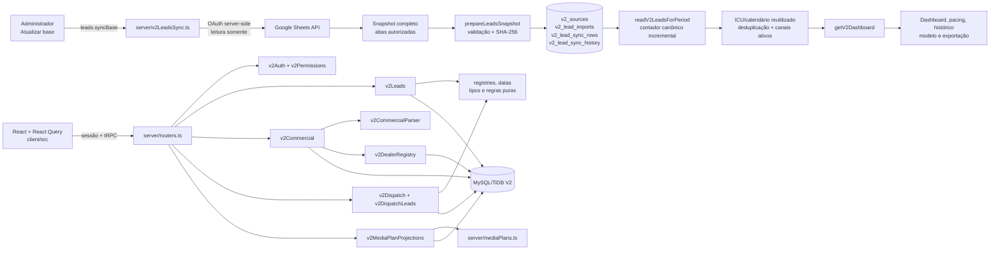

# MG Motor Brasil — Arquitetura V2

> **Projeto:** MG Motor Brasil — Leads, Performance e operação comercial.
> **Público:** cliente, operação e desenvolvimento.
> **Estado documental:** conferido no código disponível em **09/11/2026**. Este guia descreve contratos e fluxos existentes; não afirma que uma fonte externa, banco, credencial, checkpoint ou publicação esteja disponível neste ambiente.

## 1. Escopo e estado de versionamento

A V2 é uma aplicação web autenticada com frontend React, API tRPC no servidor, serviços de domínio TypeScript e persistência MySQL/TiDB compatível. O dashboard lê a base de Leads armazenada após uma importação autenticada; não consulta a planilha externa a cada renderização.

O repositório privado canônico confirmado para este trabalho é [mg-motor-brasil-dashboard](https://github.com/rodrigocordovabbro/mg-motor-brasil-dashboard). A branch de trabalho é `dashboard-v2`; `main` é a branch usada para checkpoints. A publicação automática está **desativada** (`false`) e a publicação é uma etapa separada do checkpoint. Não confundir este repositório privado com um repositório público nem afirmar que ele continua sendo uma cópia independente do Manus. O código antigo/V1 e repositórios antigos não são destinos atuais.

Há quatro estados que devem permanecer separados:

- **Fonte real:** planilha Google lida pelo servidor, snapshots XLSX autenticados ou fonte aprovada em código, conforme o módulo.
- **Valor ausente:** `null`, `N/D`, cobertura não confirmada ou status equivalente; ausência não é zero e não é preenchida por número de apresentação.
- **Versão salva:** hash, `importedAt`, snapshot ou revisão persistida no banco após uma operação transacional.
- **Versão publicada:** versão do código registrada no checkpoint de `main` e, somente depois, eventualmente publicada. Não há nesta documentação um SHA ou URL de publicação corrente confirmado.

A suíte funcional aprovada mais recentemente, segundo a evidência anterior fornecida para este projeto, foi de **463 testes em 60 arquivos**. Esse resultado é rastreabilidade anterior; nenhum teste foi executado nesta revisão documental.

A divisão de responsabilidades é:

- `client/src`: telas, componentes, filtros, estados de interação e apresentação;
- `server`: routers tRPC, sessão, autorização, leitura/escrita, parsers e serviços de domínio;
- `shared`: tipos, registries, aliases, calendário e regras puras compartilhadas;
- `drizzle`: DDL e migrações aditivas do schema V2;
- `docs`: contratos e referências documentais.

O código ativo não depende de assets externos para os fluxos documentados. O grafo abaixo é Mermaid em texto para revisão no GitHub; não é um arquivo de imagem.

## 2. Grafo de leitura e composição

### 2.1 Camadas e módulos

[`client/src/pages/Home.tsx`](../client/src/pages/Home.tsx) é o shell autenticado. Ele consulta `auth.me`, exibe login enquanto não há sessão, lê `?module=leads|media|dispatch|users`, carrega telas com `lazy`/`Suspense`, mantém o modo cliente/apresentação somente para administrador e limpa o cache do React Query no logout.

| Módulo             | Tela principal                                                              | Contrato de servidor                                              |
| ------------------ | --------------------------------------------------------------------------- | ----------------------------------------------------------------- |
| Leads              | [`V2LeadsDashboard.tsx`](../client/src/components/V2LeadsDashboard.tsx)     | `leads.dashboard`, metas, sincronização, exportação e filtros     |
| Plano de mídia     | [`MediaPlanDashboard.tsx`](../client/src/components/MediaPlanDashboard.tsx) | `mediaPlan.plans`, `projections`, `updateProjections`             |
| Controle de envios | [`V2DispatchControl.tsx`](../client/src/components/V2DispatchControl.tsx)   | `dispatch.reports`, `leadControl`, checks, preparação e histórico |
| Usuários           | [`V2UserManagement.tsx`](../client/src/components/V2UserManagement.tsx)     | `accounts.*`, somente administrador                               |

Dentro de Leads, [`LeadsSectionNavigation.tsx`](../client/src/components/LeadsSectionNavigation.tsx) mantém as quatro seções base — `Visão Geral`, `Lojas & CRM`, `Regiões` e `Leads` — e acrescenta `Análise por modelo` apenas para o administrador operacional fora do modo cliente. A aba não cria outra fonte nem outro contador.

A matriz de componentes e serviços é:

| Caminho                                                                                                       | Responsabilidade                                                                          |
| ------------------------------------------------------------------------------------------------------------- | ----------------------------------------------------------------------------------------- |
| [`client/src/components/V2LeadsDashboard.tsx`](../client/src/components/V2LeadsDashboard.tsx)                 | filtros, pacing, histórico, distribuições, tabela, abas e recarga                         |
| [`client/src/components/V2HistoricalLeadPaceCard.tsx`](../client/src/components/V2HistoricalLeadPaceCard.tsx) | curva histórica, planejado, realizado, projeção e estados de cobertura                    |
| [`client/src/components/V2AdminModelInsights.tsx`](../client/src/components/V2AdminModelInsights.tsx)         | nova análise administrativa por modelo, matrizes, comparação e gaps                       |
| [`client/src/components/V2ModelsDashboard.tsx`](../client/src/components/V2ModelsDashboard.tsx)               | distribuição modelo/versão e diagnósticos sanitizados usados no detalhamento              |
| [`client/src/components/V2LeadsReloadButton.tsx`](../client/src/components/V2LeadsReloadButton.tsx)           | ação de leitura armazenada ou sincronização Google com confirmação                        |
| [`client/src/components/V2LeadsExportButton.tsx`](../client/src/components/V2LeadsExportButton.tsx)           | exportação CSV da população filtrada integral                                             |
| [`server/routers.ts`](../server/routers.ts)                                                                   | `AppRouter`, schemas Zod e middlewares de sessão/papel                                    |
| [`server/v2LeadsSync.ts`](../server/v2LeadsSync.ts)                                                           | token Google server-side, leitura da planilha, importação transacional e single flight    |
| [`server/v2LeadsSyncMapper.ts`](../server/v2LeadsSyncMapper.ts)                                               | abas/cabeçalhos permitidos, mapeamento e hash da entrada                                  |
| [`server/v2Leads.ts`](../server/v2Leads.ts)                                                                   | leitura analítica, contador, filtros, agregação, pacing e dashboard                       |
| [`server/v2LeadCounting.ts`](../server/v2LeadCounting.ts)                                                     | contador compatível com a regra histórica, ICU/calendário, deduplicação e ciclo de canais |
| [`server/v2HistoricalLeadPace.ts`](../server/v2HistoricalLeadPace.ts)                                         | janela histórica e projeção por curvas normalizadas                                       |
| [`server/v2AdminModelInsights.ts`](../server/v2AdminModelInsights.ts)                                         | endpoint administrativo sem paginação e análise comparativa                               |
| [`server/v2LeadsExport.ts`](../server/v2LeadsExport.ts)                                                       | CSV autenticado, filtrado, integral e protegido contra fórmula                            |
| [`server/v2Commercial.ts`](../server/v2Commercial.ts)                                                         | snapshots comerciais, Retail/Registration, conciliação e lifecycle                        |
| [`server/v2CommercialParser.ts`](../server/v2CommercialParser.ts)                                             | leitura segura de XLSX, `DAILY_FUP` e `WEEKLY_REG`                                        |
| [`server/v2DealerRegistry.ts`](../server/v2DealerRegistry.ts)                                                 | extras persistidos e auditoria de dealers                                                 |
| [`server/v2Regional.ts`](../server/v2Regional.ts)                                                             | agregação de UF, região e modelo                                                          |
| [`server/v2Dispatch.ts`](../server/v2Dispatch.ts)                                                             | relatório, células, checks e auditoria                                                    |
| [`server/v2DispatchLeads.ts`](../server/v2DispatchLeads.ts)                                                   | volumes de Leads no controle CRM                                                          |
| [`server/v2DispatchDaily.ts`](../server/v2DispatchDaily.ts)                                                   | preparação diária até D-1                                                                 |
| [`server/v2MediaPlanProjections.ts`](../server/v2MediaPlanProjections.ts)                                     | overrides esparsos, lock, versão e auditoria                                              |
| [`server/mediaPlans.ts`](../server/mediaPlans.ts)                                                             | fonte aprovada do plano de mídia                                                          |

## 3. Sessão, papéis, acesso e navegação

[`server/routers.ts`](../server/routers.ts) é a referência das rotas. `v2Procedure` exige sessão V2 e define `Cache-Control: private, no-store`; `adminProcedure` exige administrador; `manualProcedure` permite validação por administrador ou BBRO; `ownerProcedure` exige administrador com username `rodrigo` para projeções de mídia e meta total de vendas. A autorização é repetida no serviço quando a operação é sensível; props da UI não provam identidade.

Os quatro papéis canônicos estão em [`shared/accountRoles.ts`](../shared/accountRoles.ts):

| Papel                          | Acesso efetivo                                                                                                                                                                            |
| ------------------------------ | ----------------------------------------------------------------------------------------------------------------------------------------------------------------------------------------- |
| `admin` — Administrador        | Todos os módulos; contas, uploads/remoções comerciais, importação Google, metas, checks, exportação e análise por modelo. O modo cliente/apresentação é controlado apenas por este papel. |
| `client` — Cliente             | Visão Geral agregada; o shell restringe a navegação a Leads/Visão Geral. Não exporta nem acessa módulos restritos.                                                                        |
| `client_admin` — ADM - Cliente | Leitura das áreas permitidas de Leads, Plano de mídia e Controle de envios; não administra contas, não importa fontes e não entra na análise por modelo.                                  |
| `bbro` — BBRO                  | Leitura das áreas permitidas e escopo CRM; pode preparar Lead Control e editar o check `Manual`/histórico, mas não administra contas, não importa Google e não faz uploads comerciais.    |

> O termo `client` é o perfil overview-only; `client_admin` não deve ser colapsado nele. Valores desconhecidos são normalizados para o perfil menos privilegiado.

Na navegação de [`Home.tsx`](../client/src/pages/Home.tsx), `Leads` é o módulo base. `Plano de mídia` e `Controle de envios` ficam ocultos para o perfil `client`; `Usuários` fica disponível somente ao administrador. Dentro de Leads, o perfil `client` recebe somente `Visão Geral`; `client_admin` e `bbro` podem usar as seções permitidas, mas a aba `Análise por modelo` continua exclusiva do administrador operacional sem modo cliente.

### 3.1 Rotas tRPC verificadas

| Grupo/procedimento                                             | Acesso no router                                     | Contrato                                                                                             |
| -------------------------------------------------------------- | ---------------------------------------------------- | ---------------------------------------------------------------------------------------------------- |
| `auth.me`, `auth.login`, `auth.logout`                         | público de transporte; sessão aplicada pelo servidor | consulta/login/logout V2                                                                             |
| `accounts.*`                                                   | `adminProcedure`                                     | listar, criar, alterar perfil/ativo e resetar senha                                                  |
| `leads.dashboard`                                              | `v2Procedure`                                        | dashboard; `dashboardForOverviewClient` para `client`, `dashboardForClient` para os demais não-admin |
| `leads.syncConnection`, `leads.syncBase`                       | `adminProcedure`                                     | estado e importação server-side da base Google                                                       |
| `leads.modelInsights`                                          | `adminProcedure`                                     | análise integral filtrada por modelo e comparação histórica                                          |
| `leads.exportCSV`                                              | `exportReadProcedure` — todos, exceto `client`       | CSV integral do recorte autenticado                                                                  |
| `leads.goal`, `leads.updateGoal`                               | `adminProcedure`                                     | meta mensal de Leads e auditoria                                                                     |
| `leads.salesGoal`, `leads.updateSalesGoal`                     | `ownerProcedure`                                     | meta total mensal de vendas para `rodrigo`                                                           |
| `mediaPlan.plans`                                              | `mediaPlanReadProcedure` — não overview-only         | plano aprovado mais overrides                                                                        |
| `mediaPlan.projections`, `updateProjections`                   | `ownerProcedure`                                     | versão, patch esparso, lock e auditoria                                                              |
| `dispatch.reports`, `dispatch.leadControl`                     | `dispatchReadProcedure` — não overview-only          | relatórios e controle CRM                                                                            |
| `dispatch.setManual`, `dispatch.history`, `prepareLeadControl` | `manualProcedure`                                    | check/histórico e preparação; BBRO recebe escopo CRM                                                 |
| `dispatch.report`, `prepareDay`, `importWorkbook`              | `adminProcedure`                                     | gestão de fonte e relatório                                                                          |
| `commercial.*`                                                 | `adminProcedure`                                     | status, preview/commit e soft-remove de fontes                                                       |

[`server/v2Permissions.ts`](../server/v2Permissions.ts) não altera a fonte. Ele projeta a resposta: agrupa modelos oficiais para o cliente, remove detalhes técnicos e notas onde necessário, mascara nome/UF conforme o modo de apresentação, retira análises restritas do overview-only e limita o controle CRM à apresentação apropriada.

## 4. Leads: leitura Google, proveniência, contador e dashboard

### 4.1 Leitura server-side e importação

O botão administrativo `leads.syncBase` chama [`server/v2LeadsSync.ts`](../server/v2LeadsSync.ts). O servidor gera uma asserção JWT de conta de serviço, solicita token OAuth com escopo de leitura do Google Sheets e usa a API Google para ler a planilha; credenciais e identificadores não são retornados ao cliente nem registrados neste guia.

A leitura de origem é limitada a abas permitidas no código (`Site`, `Meta`, `Tiktok - Live`, `Tikok`, `Weebmotors`, `Uol`, `Mercado Livre` e `Interlagos`) e ignora `Página10`. A configuração também valida metadados da planilha, intervalos, cabeçalhos, datas e valores. O mapper preserva os rótulos crus de modelo/dealer, aplica aliases controlados, não usa o ID da origem para deduplicar e identifica a ocorrência física por `(sourceSheet, sourceRow)`.

Antes de qualquer transação, [`prepareLeadsSnapshot`](../server/v2LeadsSyncMapper.ts) materializa e valida o snapshot completo, normaliza valores canônicos e calcula `inputSha256`. A transação então:

1. bloqueia a fonte `v2_sources`;
2. compara o hash da entrada com a versão salva;
3. cria uma linha imutável em `v2_lead_imports` quando há nova versão;
4. faz upsert de `v2_leads` por ocorrência física;
5. grava somente linhas novas/alteradas em `v2_lead_sync_history`;
6. atualiza o snapshot privado corrente em `v2_lead_sync_rows`;
7. recalcula totais e datas e só então atualiza `v2_sources` e confirma o commit.

Se a fonte externa falhar ou a transação não for concluída, a versão anterior é preservada. Hash idêntico retorna `changed: false` sem criar uma nova carga.

### 4.2 Proveniência privada e grafo analítico

A proveniência é separada da resposta pública:

- `v2_sources`: nome, `spreadsheetId` interno, `importedAt`, total, datas de invalidação e `inputSha256` da fonte corrente;
- `v2_lead_imports`: carga imutável, origem (`server` ou `gws`), ator, hash, total e metadados da entrada;
- `v2_lead_sync_rows`: um snapshot corrente por ocorrência física, incluindo cabeçalhos/valores/payload privados, hash da linha e `lastImportId`;
- `v2_lead_sync_history`: histórico append-only de `insert`/`update`, snapshot anterior/novo e proveniência;
- `v2_leads`: projeção operacional consultada pelo dashboard, sem serializar a proveniência bruta.

A leitura analítica em [`server/v2Leads.ts`](../server/v2Leads.ts) usa `V2_COUNTING_SOURCE_SELECT` em ordem determinística e junta somente a proveniência necessária ao contador. `readV2LeadsForPeriod` lê a população inteira antes de filtrar datas: datas corrigidas podem atravessar uma competência, e a deduplicação precisa preservar a precedência da primeira ocorrência.

Quando o pool mysql2 expõe o pool interno, a leitura usa `query(...).stream({ highWaterMark: 32 })`; sem stream, usa páginas de `1000` linhas. Em ambos os caminhos, o mesmo [`createLegacyLeadCountingAccumulator`](../server/v2LeadCounting.ts) mantém o conjunto de hashes entre páginas e produz a mesma população canônica. O nome do módulo registra compatibilidade analítica; a aplicação ativa é V2 e não depende de `legacy/` ou de repositórios antigos.

O contador reaproveita a transformação histórica de conteúdo para validar data, modelo, dealer, região, contato e canal, sem alterar a linha física nem a proveniência. Registros inválidos ficam fora da contagem analítica, mas permanecem na fonte bruta. O ciclo de canais também é explícito: canais encerrados pela regra histórica não entram no recorte ativo; TikTok e TikTok Live permanecem distintos.

O calendário de [`shared/dashboardDates.ts`](../shared/dashboardDates.ts) usa timezone `America/Sao_Paulo`, corte D-1 e formatadores `Intl.DateTimeFormat` reutilizados em um cache limitado por timezone. Isso reaproveita memória nativa de ICU em vez de criar um formatador por registro. Datas são comparadas como datas de calendário; a regra não converte o Lead em pessoa única.

### 4.3 Cache analítico e single flight

A versão da fonte (`importedAt`, `totalRows` e `inputSha256`) compõe a versão do cache analítico em `v2Leads.ts`. O resultado do contador é compartilhado enquanto a versão não muda; uma falha remove a promessa do cache para permitir nova tentativa.

Há duas proteções contra concorrência:

- no servidor, `activeGoogleSync` faz chamadas simultâneas de administradores compartilharem uma única leitura/importação corrente;
- no cliente, `activeReloadLock` no `V2LeadsDashboard` e o lock do `V2LeadsReloadButton` impedem duas recargas concorrentes, inclusive durante troca de competência ou desmontagem.

Após a sincronização, a UI invalida dashboard, análise administrativa e Lead Control sem disparar requests duplicadas, refaz a leitura do dashboard e compara **depois da sincronização** `fresh.source.importedAt` e `fresh.source.totalRows` com o resultado retornado pelo importador. Se a versão nova não for confirmada, lança `LEADS_RELOAD_VERSION_NOT_CONFIRMED`; a tela não anuncia sucesso enquanto a versão salva não for observada pelo dashboard.

### 4.4 Agregação, histórico e pacing

`getV2Dashboard` consulta a fonte, o período histórico, o registro de dealers e a meta em paralelo. A agregação mantém:

- `baseRows` para opções de filtro do período;
- `rows` para o recorte integral aplicado;
- `mtdRows` para pacing da competência até `dateTo`;
- `daily` com `null` após o último dia anunciado pela fonte e zero para dias considerados cobertos pelo predicado atual; observar a ressalva de limites físicos e início da cobertura abaixo;
- distribuições por canal, modelo, UF, cidade, dealer, hora, campanha, CRM e versão;
- matriz regional/modelo, análise modelo/versão e tabela paginada apenas como apresentação.

A meta global não é comparada quando há filtro dimensional incompatível. O total de Leads, a meta total de vendas, o `MTD Registration` e o Retail geral permanecem conceitos separados.

**Limite atual de cobertura:** a contagem usa datas corrigidas pelo acumulador, e `readV2LeadCoverage` oferece seus limites canônicos à análise administrativa. `getV2Dashboard` e os agregados da resposta de sync ainda obtêm limites físicos de `v2_leads`; além disso, `daily.sourceAvailable` verifica o limite superior, mas não o início da cobertura. Um dia anterior ao primeiro histórico pode aparecer como zero, e uma data física pode diferir da canônica. Não tratar esses zeros/limites como prova de dados completos; a unificação de cobertura é uma pendência de implementação, não um fix feito nesta revisão documental.

[`server/v2HistoricalLeadPace.ts`](../server/v2HistoricalLeadPace.ts) estende a leitura até os três meses anteriores à competência atual. A tela [`V2HistoricalLeadPaceCard.tsx`](../client/src/components/V2HistoricalLeadPaceCard.tsx) oferece `Último mês` e `Últimos 3 meses`, normaliza curvas acumuladas para calendários de 28/29/30/31 dias e calcula planejado, realizado, projeção e diferença. A média histórica exige cobertura confirmada e volume positivo; fonte não configurada, cobertura atrasada, mês vazio e ausência de meta permanecem como estados explícitos. Em recorte filtrado, a meta global não é aplicada, embora a curva histórica válida possa continuar visível.

O pacing simples de `makePacing` usa o acumulado MTD da competência até D-1: dias fechados, média/dia, projeção, esperado até D-1, restante, necessário/dia e situação (`AHEAD`, `BEHIND`, `ON_TRACK` ou `NO_GOAL`). Gráficos, KPIs e histórico não substituem a fonte nem alteram o banco.

### 4.5 Oportunidades completas na página da aba Leads — 12/11/2026

[`server/v2LeadContacts.ts`](../server/v2LeadContacts.ts) recupera os campos selecionados da proveniência da mesma oportunidade por `v2_leads.id`, em SELECTs parametrizados de até 50 IDs. Somente `getV2Dashboard().recent.rows`, após agregação, ordenação e paginação, recebe e-mail, telefone e carro de interesse; `readV2LeadsForPeriod`, o acumulador e seu cache continuam sem esses campos adicionais. Fonte não configurada e página vazia não disparam a leitura de contatos.

O contrato [`V2Lead`](../shared/v2Types.ts) aceita esses campos opcionais. Aliases são explícitos e o fallback do interesse usa apenas modelo/versão da própria linha. Ausência e proveniência malformada não criam dados; headers, values e payloads nunca são serializados. Não há associação por nome nem mudança de contagem, filtros ou datas.

[`V2OpportunityTable.tsx`](../client/src/components/V2OpportunityTable.tsx) apresenta nome completo, e-mail, telefone, carro de interesse e as dimensões operacionais existentes, com nomes sem truncamento, idiomas PT/EN e rolagem horizontal. O modo apresentação oculta nome/e-mail/telefone no DOM da tabela. As projeções de papel continuam iguais: Cliente restrito não recebe linhas individuais; perfis já autorizados à aba Leads conservam sua leitura. CSV mantém o contrato anterior; PDF da Overview continua agregado e não inclui contatos.

## 5. Análise por modelo e administração

O dashboard já calcula `modelAnalysis` sobre toda a população filtrada; a paginação da tabela recente não limita essa agregação. [`server/v2ModelAnalysis.ts`](../server/v2ModelAnalysis.ts) concilia somente aliases oficiais, classifica versões como `IDENTIFIED`, `MISSING` ou `INVALID`, mantém modelo/versão desconhecidos explícitos e sanitiza diagnósticos para não expor contatos.

A nova superfície administrativa é `leads.modelInsights`, implementada em [`server/v2AdminModelInsights.ts`](../server/v2AdminModelInsights.ts) e apresentada por [`V2AdminModelInsights.tsx`](../client/src/components/V2AdminModelInsights.tsx). Ela usa a população integral já filtrada, sem `page`, e calcula:

- mix de modelos e denominadores;
- matrizes modelo × estado, canal, dealer e campanha;
- evolução diária com `N/D` fora da cobertura;
- comparação com a janela anterior de mesma duração e filtros dimensionais;
- oportunidades de gap de mix somente com amostra e categoria identificada;
- gaps de qualidade de modelo, versão, UF, dealer e campanha;
- diagnósticos de origem sem linhas individuais, contatos ou credenciais.

O endpoint é administrativo; o campo de contrato documenta `audience: "admin"`. Comparação anterior não coberta retorna `NOT_AVAILABLE`, não zero. Uma tela vazia, fonte ausente ou amostra baixa permanece rotulada como tal. [`shared/adminModelInsights.ts`](../shared/adminModelInsights.ts) é o contrato de tipos dessa superfície.

## 6. Exportação CSV autenticada

O botão [`V2LeadsExportButton.tsx`](../client/src/components/V2LeadsExportButton.tsx) chama `leads.exportCSV` por tRPC com a sessão atual. [`server/v2LeadsExport.ts`](../server/v2LeadsExport.ts) verifica que a fonte está pronta, lê o recorte completo, ignora `input.page`, usa o mesmo período, cache, registro de dealers, predicado canônico e ordenação do dashboard, e retorna o CSV na resposta autenticada.

O arquivo contém todos os registros do recorte aplicado, não somente a página atual. O modo de apresentação mascara nomes; para papéis não-admin a apresentação agrupa UF conforme a projeção autorizada. O gerador usa BOM UTF-8, CRLF, separador `;`, proteção contra injeção de fórmula e limites técnicos de linhas/bytes. Não há URL pública de exportação nem acesso por uma rota sem sessão.

## 7. Comercial: Retail geral, Registration e snapshots por dealer

O parser e o serviço comercial distinguem claramente o total geral da rede da leitura por dealer.

### 7.1 Fontes reais

- `lead-goals`: metas de Leads por fonte comercial, com total da própria carga quando presente;
- `sales-goals`: metas de vendas por dealer/grupo, em arquivo próprio;
- `sales`: prioriza `WEEKLY_REG`, com `CUSTOMER_NAME` e `W1_Reg` a `W6_Reg`, conforme pedido de 11/11/2026. Preserva os seis snapshots em `rowsJson.weeklySales` e sua `sourceSheet`, sem nova tabela ou migration; a coluna ativa é escolhida por `sourceWeek`/`asOf` e W4 é a referência mensal quando preenchida. Sem escolha explícita, o fechamento fica limitado a W4. Uma REG malformada não recorre silenciosamente à RET;
- `WEEKLY_RET`: compatibilidade somente quando `WEEKLY_REG` não existe; mantém colunas `Wn_Retail` e identidade Retail. Fontes antigas permanecem imutáveis. O reader JSON aceita REG e RET, e `dealerSalesKind` identifica a métrica semanal sem confundi-la com os totais gerais;
- `DAILY_FUP`: somente metadados gerais no bloco `Current Month` das primeiras linhas permitidas.

No `DAILY_FUP`, `MTD Registration` é o registro geral de emplacamentos e `Retail` é o total geral de Retail. Nenhum dos dois é transformado em linha de dealer. O header ativo de Retail é exatamente `Retail`; `MTD Retail`/`Retail MTD` são identificados como alias legado e não são tratados como uma nova fonte geral válida. A data `registrationAsOf`/`retailAsOf` vem do rótulo de arquivo quando confiável e permanece independente do `asOf` semanal por dealer.

A carga `sales` grava `retailMtd`/`retailAsOf` e `registrationMtd`/`registrationAsOf` no snapshot imutável. Quando o bloco geral Retail está disponível, o total global comparável vem de Retail. Se o bloco estiver ausente, o valor geral permanece ausente; uma soma conhecida de `WEEKLY_REG` pode aparecer apenas como referência/aviso por loja e não substitui o Retail geral. `MTD Registration` também não substitui Retail.

### 7.2 Performance e comparação

[`getCommercialPerformance`](../server/v2Commercial.ts) usa snapshots mais recentes por `kind` e competência, metas manuais e registry de dealers. As linhas recebem o snapshot ativo de `WEEKLY_REG` (ou Retail histórico/compatível identificado) quando o período cobre a competência desde o dia 1 até `asOf`, sem filtro incompatível. A tabela semanal mostra a fonte original, W1–W6, W4/Mês, conversão e Leads por venda. Semanas vazias são N/D. Grupos são coletivos, sem rateio, incluindo o de-para comercial explícito `EUROVILLE BH/JF/UB`; filtros incompatíveis ocultam as semanas e razões por unidade.

O total executivo `sales` e a razão global usam o Retail geral quando disponível. Divergências com a soma de lojas permanecem explícitas, sem ajuste de dados. Conversão por unidade é `vendas / Leads`; Leads por venda é `Leads / vendas`, somente com denominadores válidos e corte comparável. Para semanas REG/RET preservadas, o corte semanal é independente da data rotulada do Registration geral; a proteção temporal legada permanece em snapshots antigos sem semanas. Tabela, rankings e PDF identificam Registration ou Retail por dealer; mapeamentos coletivos, extras e rótulos não conciliados são rastreáveis, sem inferência por substring.

`preview` não grava. `commit` faz o parse novamente, registra snapshot e mapping hash em transação, cria extras confirmados quando necessário e invalida as consultas. `remove` faz soft-remove da última revisão com `expectedImportId`; snapshots históricos não são apagados e uma revisão removida não reaparece por fallback automático.

## 8. Plano de mídia e controle de envios

O plano aprovado vem de [`server/mediaPlans.ts`](../server/mediaPlans.ts). [`server/v2MediaPlanProjections.ts`](../server/v2MediaPlanProjections.ts) aplica overrides esparsos por mês, escopo global/produto/linha, controle de versão otimista, lock e auditoria. Overrides não alteram orçamento, investimento importado, comissão ou linhas da fonte aprovada.

O dispatch é uma fotografia importada: relatório, linhas por loja, células por dia, integração informativa `SYONET`/`BBRO`, volume e checks. `Manual` é a validação editável por administrador/BBRO; cada alteração verifica `expectedVersion`, usa transação e grava auditoria. O controle de Leads reutiliza `filterV2LeadRows`; `prepareLeadControl` é idempotente, preserva checks e, para BBRO, aplica o escopo de CRM. `volume` nulo e `sourcePending` significam fonte ainda não pronta, não zero.

## 9. Persistência e migrações V2

Os DDLs são explícitos, aditivos e separados do bootstrap do servidor. A aplicação não executa migrations/importações no startup. A persistência relevante é:

| Tabela/arquivo                                                          | Papel                                                                                          |
| ----------------------------------------------------------------------- | ---------------------------------------------------------------------------------------------- |
| [`v2-base.sql`](../drizzle/v2-base.sql)                                 | `v2_accounts`, `v2_sources`, `v2_leads`, metas mensais de Leads e auditoria                    |
| [`v2-leads-sync.sql`](../drizzle/v2-leads-sync.sql)                     | cargas, snapshot corrente e histórico privado de proveniência                                  |
| [`v2-commercial.sql`](../drizzle/v2-commercial.sql)                     | snapshots imutáveis de `lead-goals`, `sales-goals` e `sales`, hash e mapping                   |
| [`v2-registration.sql`](../drizzle/v2-registration.sql)                 | colunas opcionais `registrationMtd` e `registrationAsOf` adicionadas com verificação explícita |
| [`v2-retail.sql`](../drizzle/v2-retail.sql)                             | colunas opcionais `retailMtd` e `retailAsOf`, também aplicadas manualmente após `SHOW COLUMNS` |
| [`v2-commercial-lifecycle.sql`](../drizzle/v2-commercial-lifecycle.sql) | soft-remove, reativação e auditoria append-only                                                |
| [`v2-dealer-registry.sql`](../drizzle/v2-dealer-registry.sql)           | extras de dealer, vínculo com importação e ator                                                |
| [`v2-sales-goal.sql`](../drizzle/v2-sales-goal.sql)                     | override total mensal de vendas, auditoria e mutex                                             |
| [`v2-dispatch.sql`](../drizzle/v2-dispatch.sql)                         | relatórios, linhas, células, checks versionados e auditoria                                    |
| [`v2-dispatch-daily.sql`](../drizzle/v2-dispatch-daily.sql)             | `volume` anulável, `sourcePending` e imports diários                                           |
| [`v2-media-projections.sql`](../drizzle/v2-media-projections.sql)       | versões, overrides e auditoria de projeções                                                    |
| [`v2-accounts.sql`](../drizzle/v2-accounts.sql)                         | auditoria de contas e marcadores de migração                                                   |
| [`v2-client-profiles.sql`](../drizzle/v2-client-profiles.sql)           | marcador da migração aditiva dos perfis canônicos; não cria conta, senha ou dado operacional   |

O runner de contas adiciona/verifica `role` e `sessionVersion` sem voltar ao enum antigo. A migração de perfis valida o enum aditivo de quatro valores e usa `v2_user_migrations`/`v2_account_audit`; ela não cria linhas de conta, senha, status, Leads, CRM, metas ou snapshots por conta própria. Os arquivos de Retail e Registration são revisáveis e não são importados pelo startup. O arquivo de Retail não autoriza tratar alias legado como Retail geral.

[`server/v2Db.ts`](../server/v2Db.ts) abre a conexão somente no servidor. O cliente recebe contratos tRPC, não `DATABASE_URL`, credenciais, payloads privados de Sheets, hashes de senha ou detalhes de erro SQL. Tabelas de proveniência podem conter campos de contato e são selecionadas somente por serviços internos autorizados.

## 10. Referências de implementação

- [Shell e módulos](../client/src/pages/Home.tsx)
- [Dashboard de Leads](../client/src/components/V2LeadsDashboard.tsx)
- [Navegação de Leads](../client/src/components/LeadsSectionNavigation.tsx)
- [Recarga e confirmação de versão](../client/src/components/V2LeadsReloadButton.tsx)
- [Histórico e pacing](../client/src/components/V2HistoricalLeadPaceCard.tsx)
- [Análise administrativa por modelo](../client/src/components/V2AdminModelInsights.tsx)
- [Modelos e versões](../client/src/components/V2ModelsDashboard.tsx)
- [Exportação CSV](../client/src/components/V2LeadsExportButton.tsx)
- [Router e acesso](../server/routers.ts)
- [Permissões e redaction](../server/v2Permissions.ts)
- [Sincronização Google](../server/v2LeadsSync.ts)
- [Mapper e proveniência](../server/v2LeadsSyncMapper.ts)
- [Leitura, contador e agregação](../server/v2Leads.ts)
- [Contador compatível e calendário](../server/v2LeadCounting.ts)
- [Formatadores/corte D-1](../shared/dashboardDates.ts)
- [Tipos de Leads](../shared/v2Types.ts)
- [Papéis](../shared/accountRoles.ts)
- [Contrato de recarga](../shared/leadsReload.ts)
- [Contrato de sincronização](../shared/leadsSync.ts)
- [Contrato do CSV](../shared/leadsExport.ts)
- [Contrato de histórico](../shared/historicalLeadPace.ts)
- [Contrato de análise administrativa](../shared/adminModelInsights.ts)
- [Registries de modelo, estado e dealer](../shared/modelRegistry.ts), [`stateRegistry.ts`](../shared/stateRegistry.ts), [`dealerRegistry.ts`](../shared/dealerRegistry.ts) e [`dealerRegistryExtensions.ts`](../shared/dealerRegistryExtensions.ts)
- [Serviço comercial](../server/v2Commercial.ts)
- [Parser comercial](../server/v2CommercialParser.ts)
- [Registro de dealers](../server/v2DealerRegistry.ts)
- [Controle de envios](../server/v2Dispatch.ts) e [Lead Control](../server/v2DispatchLeads.ts)
- [Projeções do plano de mídia](../server/v2MediaPlanProjections.ts)
- [Schema base](../drizzle/v2-base.sql) e [proveniência](../drizzle/v2-leads-sync.sql)
- [Snapshots comerciais](../drizzle/v2-commercial.sql), [lifecycle](../drizzle/v2-commercial-lifecycle.sql), [Registration](../drizzle/v2-registration.sql) e [Retail](../drizzle/v2-retail.sql)
- [Contas e perfis](../drizzle/v2-accounts.sql) e [`v2-client-profiles.sql`](../drizzle/v2-client-profiles.sql)
