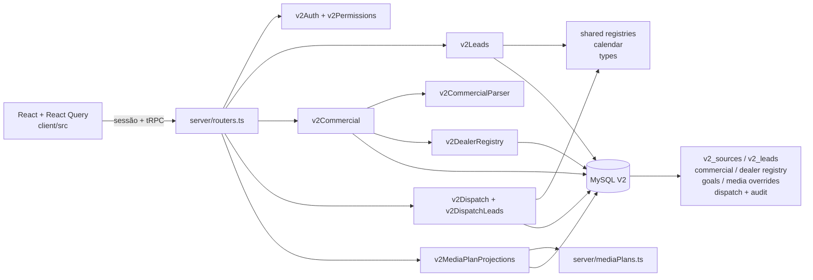

# MG Motor Brasil — Arquitetura V2

> **Projeto:** MG Motor Brasil — Leads, Performance e operação comercial.
> **Público:** cliente, operação e developer.
> **Estado documentado:** arquitetura observada no código e nos testes em **06/11/2026**. A documentação descreve contratos existentes; não implica que uma integração, dado ou deploy futuro já esteja configurado.

## 1. Visão geral

A V2 é uma aplicação web autenticada com frontend React, API tRPC no servidor, serviços de domínio TypeScript e persistência MySQL. O dashboard não consulta uma planilha externa a cada renderização: a carga autenticada inicial grava a fonte em tabelas V2 e as consultas posteriores leem o banco. As planilhas comerciais são processadas sob demanda pelo parser XLSX, primeiro em prévia e depois em commit transacional.

A divisão central é:

- `client/src`: telas, componentes, filtros, estados de interação e apresentação;
- `server`: routers tRPC, autenticação, autorização, leitura/escrita, parsers e serviços de domínio;
- `shared`: tipos, registries, aliases, calendário e regras puras compartilhadas por servidor e cliente;
- `drizzle`: DDL/migrações e extensões de schema V2;
- `docs`: documentação pública deste contrato.

O código ativo não depende de assets externos para os fluxos documentados. O grafo abaixo é Mermaid em texto para revisão no GitHub; não é um arquivo de imagem nem exige renderização no repositório.



## 2. Composição da aplicação

### 2.1 Entrada autenticada e módulos

[`client/src/pages/Home.tsx`](../client/src/pages/Home.tsx) é o shell autenticado. Ele:

1. consulta `auth.me` e mostra login até existir sessão;
2. seleciona o módulo por `?module=leads|media|dispatch|users`;
3. carrega as telas com `lazy`/`Suspense`;
4. expõe o modo cliente/apresentação somente ao administrador;
5. limpa o cache do React Query no logout.

Os módulos visíveis são:

| Módulo | Tela principal | Contrato de servidor |
|---|---|---|
| Leads | [`V2LeadsDashboard.tsx`](../client/src/components/V2LeadsDashboard.tsx) | `leads.dashboard`, metas e filtros |
| Plano de mídia | [`MediaPlanDashboard.tsx`](../client/src/components/MediaPlanDashboard.tsx) | `mediaPlan.plans`, `projections`, `updateProjections` |
| Controle de envios | [`V2DispatchControl.tsx`](../client/src/components/V2DispatchControl.tsx) | `dispatch.reports`, `leadControl`, checks e preparação |
| Usuários | `V2UserManagement.tsx` | `accounts.*`, somente administrador |

No módulo Leads, [`LeadsSectionNavigation.tsx`](../client/src/components/LeadsSectionNavigation.tsx) mantém quatro abas em uma única barra: `Visão Geral`, `Regiões`, `Lojas & CRM` e `Leads`. A aba selecionada altera o painel; não cria uma segunda fonte nem outro cálculo.

### 2.2 API e fronteiras de autorização

[`server/routers.ts`](../server/routers.ts) define o `AppRouter` e os middlewares:

- `v2Procedure`: exige sessão V2 e envia `Cache-Control: private, no-store`;
- `adminProcedure`: exige papel `admin`;
- `manualProcedure`: permite `admin` e `bbro` para operações de conferência CRM;
- `ownerProcedure`: exige administrador com username `rodrigo` para edição de projeções de mídia e metas totais de vendas.

[`server/v2Permissions.ts`](../server/v2Permissions.ts) é a camada de projeção de resposta. `dashboardForClient` remove avisos e detalhes técnicos selecionados; `dispatchForClient` mascara o username do auditor para o modo cliente; `controlForCRM` reduz a apresentação às unidades do escopo CRM sem alterar o objeto de origem.

A regra de autorização é repetida no serviço quando a operação é sensível. Props da UI nunca são tratadas como prova de identidade.

## 3. Diretórios e responsabilidades

| Caminho público | Responsabilidade | Entradas/saídas relevantes |
|---|---|---|
| [`client/src/pages/Home.tsx`](../client/src/pages/Home.tsx) | shell, login, módulos e preferência de apresentação | sessão, `module`, papel |
| [`client/src/components/V2LeadsDashboard.tsx`](../client/src/components/V2LeadsDashboard.tsx) | filtros, pacing, distribuições, tabela comercial e abas | `V2Dashboard` |
| [`client/src/components/newcomponentV2RegionalModelMatrix.tsx`](../client/src/components/newcomponentV2RegionalModelMatrix.tsx) | matriz região/UF × modelo | `RegionalModelDistribution` |
| [`client/src/components/V2CommercialUploads.tsx`](../client/src/components/V2CommercialUploads.tsx) | upload de vendas WEEKLY_REG e status/remoção | preview/commit de `sales` |
| [`client/src/components/V2CombinedGoalsUpload.tsx`](../client/src/components/V2CombinedGoalsUpload.tsx) | upload combinado de metas | `DEALER/TOTAL DEALER/SALES` |
| [`client/src/components/V2DispatchControl.tsx`](../client/src/components/V2DispatchControl.tsx) | tabela por loja/dia, filtro Manual, histórico | `DispatchReport` |
| [`client/src/components/MediaPlanDashboard.tsx`](../client/src/components/MediaPlanDashboard.tsx) | plano aprovado, CPL e editor Rodrigo | plano + overrides |
| [`server/routers.ts`](../server/routers.ts) | contrato tRPC e validação Zod | procedimentos protegidos |
| [`server/v2Leads.ts`](../server/v2Leads.ts) | leitura, filtros, agregação e pacing | `v2_leads` → `V2Dashboard` |
| [`server/v2Commercial.ts`](../server/v2Commercial.ts) | snapshots comerciais, conciliação, performance e lifecycle | imports + dashboard |
| [`server/v2CommercialParser.ts`](../server/v2CommercialParser.ts) | leitura segura de XLSX e regras de abas/colunas | base64 → preview |
| [`server/v2DealerRegistry.ts`](../server/v2DealerRegistry.ts) | extras de concessionária em transação | `v2_dealer_registry` |
| [`server/v2Regional.ts`](../server/v2Regional.ts) | agregação de UF, região e modelo | matriz regional |
| [`server/v2Dispatch.ts`](../server/v2Dispatch.ts) | relatório, checks, versão e auditoria | tabelas dispatch |
| [`server/v2DispatchLeads.ts`](../server/v2DispatchLeads.ts) | volumes diários de Leads no controle CRM | `v2_leads` + relatório |
| [`server/v2DispatchDaily.ts`](../server/v2DispatchDaily.ts) | catch-up de dias até D-1 | células pendentes |
| [`server/v2MediaPlanProjections.ts`](../server/v2MediaPlanProjections.ts) | overrides esparsos, locks e auditoria | planos aprovados + DB |
| [`server/mediaPlans.ts`](../server/mediaPlans.ts) | fonte aprovada mensal de mídia | Jul–Out/2026 observado |
| [`shared/modelRegistry.ts`](../shared/modelRegistry.ts) | cinco modelos e aliases exatos | canonicalização de modelo |
| [`shared/stateRegistry.ts`](../shared/stateRegistry.ts) | 27 UFs, cinco regiões e aliases | canonicalização geográfica |
| [`shared/dealerRegistry.ts`](../shared/dealerRegistry.ts) | 41 unidades oficiais, CRM 40 e de-para | resolução de dealer |
| [`shared/dealerRegistryExtensions.ts`](../shared/dealerRegistryExtensions.ts) | catálogo combinado e classificação de extras/grupos | official + persisted extras |
| [`shared/dashboardDates.ts`](../shared/dashboardDates.ts) | São Paulo, D-1 e períodos | intervalo resolvido |
| [`shared/v2Types.ts`](../shared/v2Types.ts) | contratos do dashboard e filtros | tipos cliente/servidor |

## 4. Fluxos de dados

### 4.1 Leads: fonte importada → dashboard

```text
fonte XLSX autenticada
  → importador da base V2
  → v2_sources + v2_leads
  → getV2Dashboard(filters)
      → resolveDashboardPeriod (São Paulo/D-1)
      → lê v2_leads no intervalo mensal necessário
      → filterV2LeadRows (período + modelo/canal/campanha/dealer/busca)
      → agregações de canal/modelo/UF/cidade/dealer/hora/campanha/CRM
      → aggregateRegionalModels
      → getCommercialPerformance (competência de dateTo)
      → resposta V2Dashboard
  → dashboardForClient quando o papel não é admin
```

`aggregateV2Leads` mantém duas coleções: `baseRows` para opções do recorte de período e `rows` para o recorte completo aplicado. O pacing usa ainda `mtdRows` da competência de `dateTo`. A função `matchesV2LeadFilters` é compartilhada pelo dashboard e pelo controle de Leads, evitando uma contagem divergente entre as telas.

O botão [`V2LeadsReloadButton.tsx`](../client/src/components/V2LeadsReloadButton.tsx) chama `leads.syncBase` para administradores: importa o snapshot real da planilha por conta de serviço Google própria, aplica transação e só depois atualiza os caches. Sem credencial/acesso não há sucesso fictício. Cliente/BBRO apenas relêem o banco. A sincronização é manual; não há polling de planilha, conexão CRM nem fallback local de números. Consulte [configuração segura](./OPERACAO_E_DEPLOY.md#12-sincronização-manual-real-da-planilha-base-de-leads).

### 4.2 Metas e fontes comerciais

```text
XLSX em memória
  → commercial.preview / previewGoals
      → decode base64 + limites ZIP
      → parser por kind/aba/cabeçalho
      → aliases oficiais e sugestões de mapping
      → preview sem escrita
  → commercial.commit / commitGoals
      → parse novamente no servidor
      → transação
          → v2_commercial_imports (snapshot imutável)
          → v2_dealer_registry (extras confirmados, se houver)
          → estado/auditoria de lifecycle
          → goal import default, sem substituir meta manual
      → commit + invalidação de queries
```

`previewGoals` interpreta a tabela combinada apenas com `DEALER`, `TOTAL DEALER` e `SALES`. `commitGoals` grava dois kinds (`lead-goals` e `sales-goals`) na mesma transação. Mapping coletivo permanece coletivo; não existe distribuição automática para unidades.

A carga de `sales` requer `WEEKLY_REG` e uma única coluna W1–W6. `DAILY_FUP` é lida apenas para o campo geral `MTD Registration` no bloco superior permitido, sem transformar o valor em linha de dealer.

### 4.3 Performance comercial no dashboard

`getCommercialPerformance` usa a competência de `filters.dateTo` para selecionar os snapshots mais recentes. `buildOfficialCommercialPerformance` constrói linhas de trabalho em três conjuntos:

1. unidades oficiais;
2. extras persistidos no registro dinâmico;
3. rótulos não conciliados, preservados como origem.

As metas por linha só são comparáveis em uma competência e sem recorte dimensional incompatível. O total global de Leads, a meta total de vendas e a conversão são calculados separadamente das linhas de dealer. O `MTD Registration` geral não é alocado nas lojas.

### 4.4 Dispatch/CRM

```text
dispatch.report → fotografia importada (layout, lojas, células e checks)
        │
        └─ dispatch.leadControl(reportId, filters)
             → mesmo filterV2LeadRows de Leads
             → mapLeadRows por alias/histórico/exato
             → volume por rowId + data
             → cells com volume null quando a fonte não está pronta

manualProcedure → dispatch.setManual(cellId, isOk, expectedVersion)
              → lock da célula
              → check version + transação
              → v2_dispatch_checks + v2_dispatch_check_audit
```

O status de integração `SYONET`/`BBRO` é informação de fonte; não é uma conexão ativa. O check `Manual` é a única validação editável. `prepareLeadControl` cria células pendentes e mapping persistido de maneira idempotente, preservando checks; para BBRO aplica o escopo fechado de 40 unidades CRM e D-1.

### 4.5 Plano de mídia

```text
MEDIA_PLANS (fonte aprovada em server/mediaPlans.ts)
        + readMediaPlanProjections(monthId)
        → applyMediaPlanProjectionOverrides
        → plano apresentado + CPL recalculado

Rodrigo/admin → updateProjections(expectedVersion, patch)
        → valida mês/produto/linha/inteiro
        → cria/locka versão
        → substitui conjunto esparso do mês
        → grava auditoria oldValues/newValues
```

A fonte aprovada é imutável. Overrides são separados por escopo global, produto e linha. Um override global altera headline e CPL, mantendo detalhe de produto/linha. O editor usa controle de versão otimista e retorna conflito quando outra gravação ocorreu.

## 5. Persistência V2

As tabelas são criadas ou estendidas pelos SQLs públicos em [`drizzle/`](../drizzle/). A persistência relevante é:

| Tabela/arquivo | Papel | Garantia importante |
|---|---|---|
| `v2_sources`, `v2_leads` em [`v2-base.sql`](../drizzle/v2-base.sql) | fonte e registros de Leads | unique por planilha/linha; índices por data/canal |
| `v2_lead_goals`, `v2_goal_audit` em [`v2-base.sql`](../drizzle/v2-base.sql) | meta mensal de Leads | competência + histórico; manual pode assumir a competência |
| `v2_commercial_imports` em [`v2-commercial.sql`](../drizzle/v2-commercial.sql) | snapshots de metas/vendas | identity por kind, competência, hash e mapping |
| lifecycle comercial em [`v2-commercial-lifecycle.sql`](../drizzle/v2-commercial-lifecycle.sql) | soft-remove e auditoria | latest removido não faz fallback automático |
| `v2_dealer_registry` em [`v2-dealer-registry.sql`](../drizzle/v2-dealer-registry.sql) | extras confirmados | chave normalizada única; vínculo com importação/ator |
| `v2_sales_total_goals` em [`v2-sales-goal.sql`](../drizzle/v2-sales-goal.sql) | override total manual de vendas | separado de metas por loja e snapshots |
| overrides de mídia em [`v2-media-projections.sql`](../drizzle/v2-media-projections.sql) | valores esparsos e versões | PK por mês/tipo/chave + auditoria old/new |
| dispatch em [`v2-dispatch.sql`](../drizzle/v2-dispatch.sql) | relatório, loja, célula e check | checks versionados e auditados |
| extensões diárias em [`v2-dispatch-daily.sql`](../drizzle/v2-dispatch-daily.sql) | `volume` nullable, pending e imports | ausência fica pendente, não zero |
| metadata Registration em [`v2-registration.sql`](../drizzle/v2-registration.sql) | MTD Registration do snapshot | valor geral separado da venda por dealer |

O serviço [`server/v2Db.ts`](../server/v2Db.ts) abre o pool a partir de `DATABASE_URL` somente no servidor. O cliente recebe contratos tRPC, não credenciais ou conexão MySQL.

## 6. Parser e limites de upload

[`server/v2CommercialParser.ts`](../server/v2CommercialParser.ts) valida base64 e XLSX antes do `ExcelJS`:

- base64 comercial até 1,4 MB;
- arquivo ZIP até 1 MiB;
- limites de entradas e expansão descompactada;
- somente `.xlsx`;
- inteiros seguros não negativos para quantidades;
- cabeçalhos procurados nas primeiras linhas permitidas;
- valores de fórmula lidos pelo resultado calculado;
- hash SHA-256 da entrada para identidade/idempotência.

A validação de colunas é por alias controlado. Ela não transforma uma planilha genérica em fonte oficial por semelhança de nomes.

## 7. Contrato de telas e API

### Leads

| Procedimento | Acesso | Uso |
|---|---|---|
| `leads.dashboard` | sessão | período, filtros e payload `V2Dashboard` |
| `leads.goal` | admin | lê meta mensal de Leads |
| `leads.updateGoal` | admin | salva meta manual e auditoria |
| `leads.salesGoal` | Rodrigo/admin owner | lê override total de vendas |
| `leads.updateSalesGoal` | Rodrigo/admin owner | salva override total de vendas |

### Comercial

| Procedimento | Acesso | Uso |
|---|---|---|
| `commercial.status` | admin | fontes ativas por competência |
| `commercial.previewGoals` / `commitGoals` | admin | metas combinadas |
| `commercial.preview` / `commit` | admin | snapshot de venda ou fonte comercial |
| `commercial.remove` | admin | soft-remove com `expectedImportId` |

### Dispatch

| Procedimento | Acesso | Uso |
|---|---|---|
| `dispatch.reports` | sessão | lista relatórios; cliente recebe título seguro |
| `dispatch.leadControl` | sessão | volume por Leads + projeção de resposta |
| `dispatch.setManual` / `history` | admin/BBRO | check versionado e histórico |
| `dispatch.prepareLeadControl` | admin/BBRO | prepara células, com escopo BBRO |
| `dispatch.report`, `prepareDay`, `importWorkbook` | admin | gestão de fonte/relatório |

### Mídia

| Procedimento | Acesso | Uso |
|---|---|---|
| `mediaPlan.plans` | sessão | plano aprovado + overrides aplicados |
| `mediaPlan.projections` | Rodrigo | leitura do patch esparso e versão |
| `mediaPlan.updateProjections` | Rodrigo | patch validado, lock, versão e auditoria |

## 8. Segurança, cópia pública e operação

A autenticação usa sessão V2 protegida no servidor. O cliente não recebe `DATABASE_URL`, segredos de assinatura, chaves privadas, hashes de senha ou detalhes de erro SQL; respostas de cliente usam redaction e erros genéricos quando apropriado.

Uma cópia pública no GitHub deve ser entendida como **código e documentação**, não como uma cópia do ambiente executável. O repositório não carrega automaticamente:

- banco MySQL e seus dados;
- usuários, sessões, hashes ou checks persistidos;
- segredos e variáveis privadas;
- integrações da sessão/connector;
- URLs de serviços fornecidas pelo ambiente;
- configuração de plataforma gerenciada;
- deploy, storage, DNS ou credenciais de produção.

Por isso, clonar o código não transporta dados, usuários ou sessão. Ambiente, migrações e variáveis devem ser provisionados separadamente pelo responsável autorizado. Esta documentação não registra valores secretos, IDs de fontes externas nem endereços privados.

A pasta `legacy/`, quando presente no workspace de desenvolvimento, é preservada como histórico e não pertence ao grafo ativo da V2. Os fluxos documentados usam os sourcefiles V2 citados nesta página; não há dependência operacional de código legado.

## 9. Testes e rastreabilidade

Em execução local observada em **06/11/2026**, `pnpm test -- --reporter=dot` passou com **33 arquivos e 218 testes**. As suítes cobrem:

- calendário de São Paulo, D-1, presets e filtros;
- modelos, estados/regiões e cadastro 41/40;
- parser combinado com 31 linhas, 10.579 Leads de meta e 591 vendas de meta;
- WEEKLY_REG sem soma entre W1–W6 e DAILY_FUP sem atribuição por dealer;
- conversão MTD e guardas de escopo;
- registro dinâmico, transações, lifecycle/reupload;
- dispatch, BBRO, versionamento de checks e apresentação;
- projeções esparsas e conflito de versão;
- autenticação, papéis e redaction.

O resultado é uma evidência do estado observado na data indicada. Ele não certifica conectividade de CRM, disponibilidade do banco de produção, execução de deploy ou comportamento de versões futuras.

## 10. Referências públicas de implementação

- [Tipos de filtros e dashboard](../shared/v2Types.ts)
- [Tipos comerciais](../shared/v2Commercial.ts)
- [Tipos de dispatch](../shared/v2Dispatch.ts)
- [Tipos de plano de mídia](../shared/v2MediaPlan.ts)
- [Regras de projeção](../shared/v2MediaPlanProjections.ts)
- [Papéis e permissões básicas](../shared/accountRoles.ts)
- [Router tRPC](../server/routers.ts)
- [Serviço de Leads](../server/v2Leads.ts)
- [Serviço comercial](../server/v2Commercial.ts)
- [Parser XLSX](../server/v2CommercialParser.ts)
- [Serviço de registro dinâmico](../server/v2DealerRegistry.ts)
- [Serviço regional](../server/v2Regional.ts)
- [Serviço de controle de Leads/dispatch](../server/v2DispatchLeads.ts)
- [Serviço de dispatch e auditoria](../server/v2Dispatch.ts)
- [Serviço de projeções](../server/v2MediaPlanProjections.ts)
